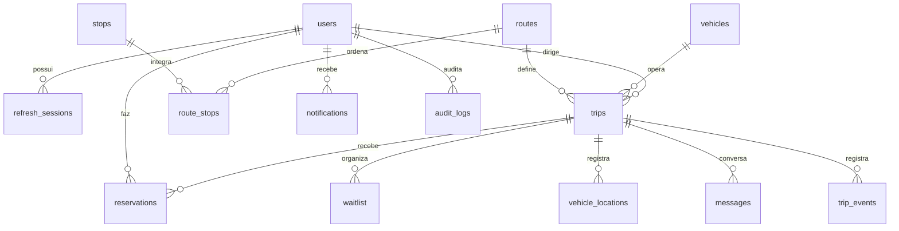

# Arquitetura e decisões

Next.js 16 / React 19 → REST NestJS e Socket.IO → serviços por domínio → Drizzle / PostgreSQL Neon. Frontend sem segredos e sem fonte paralela de dados. TanStack Query reconcilia dados após eventos e reconexão.

Autenticação em cookies HttpOnly, access JWT curto e refresh aleatório com hash, rotação transacional, origem exigida em mutações. Conexões WS verificam origem, sessão e participação a cada mensagem. Cadastro público sempre professor. Revogar sessão invalida também JWTs e sockets.

Fluxo: usuários/veículos/rotas/pontos → viagens → reservas → rastreamento/chat → notificações/relatórios. Restrição de horário é serializada com locks sobre veículo e motorista. Reservas, cancelamentos, ofertas e confirmações serializam pela linha da viagem; ofertas válidas também consomem capacidade. Estados são validados no servidor.

Acesso: admin acompanha tudo; motorista somente viagens atribuídas; professor somente viagens públicas disponíveis ou viagens vinculadas para dados gerais, e reserva ativa/histórica para mensagens/localização conforme estado. Localização nunca é pública. Histórico limitado e retenção configurável.

Eventos são emitidos após commit. Notificações persistem e podem ser recuperadas após desconexão. Socket.IO inicia com uma instância; múltiplas instâncias exigem adapter Redis, rate limiter compartilhado e worker único para tarefas agendadas. Não há alegação de entrega exatamente uma vez.

GPS real e simulador usam TrackingService. Viagens têm is_demo imutável; simulador recusa viagens reais. ETA usa roteamento OSRM, sem afirmar trânsito real. Coordenadas de demonstração não representam pontos oficiais.

## Validação por fase

1. Fundação: dependências, schema, migração, build.
2. Autenticação: registro, rotação, revogação, RBAC.
3. Operação: CRUD, conflitos e estados.
4. Reservas: concorrência na última vaga e fila.
5. Monitoramento: permissão WS, persistência e simulação isolada.
6. Comunicação: mensagens, notificações e ETA.
7. Administração: indicadores de SQL e CSV.
8. Finalização: lint, typecheck, testes e navegador. Evidência real é registrada em docs/validation.md.

## Banco de dados

A aplicação e as migrações usam exclusivamente o Neon. PGlite é uma dependência de desenvolvimento da API, utilizada apenas nos testes de integração em memória; não faz parte do adapter de banco da aplicação e não persiste dados locais.
